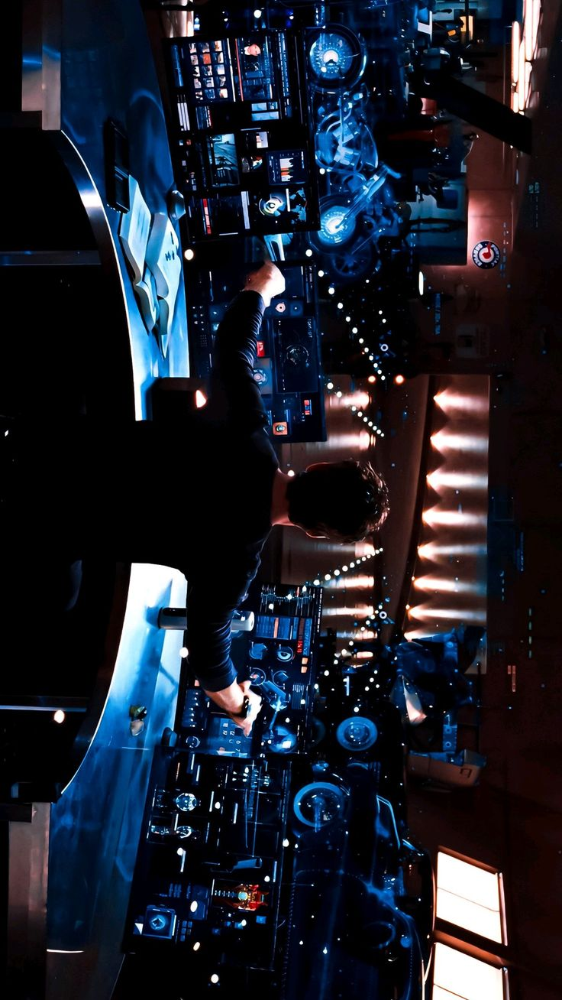
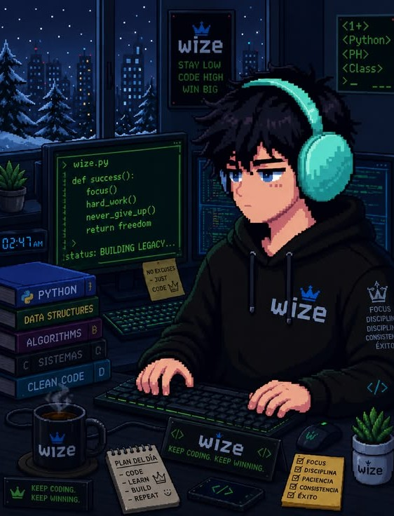

<div align="center">

<!-- ═══════════════════════════════════════════════════════════════════ -->
<!--                          HEADER BANNER                              -->
<!-- ═══════════════════════════════════════════════════════════════════ -->



<!-- ═══════════════════════════════════════════════════════════════════ -->
<!--                        TYPING ANIMATION                             -->
<!-- ═══════════════════════════════════════════════════════════════════ -->

[](https://git.io/typing-svg)

<br/>

<!-- ═══════════════════════════════════════════════════════════════════ -->
<!--                        PHOTO + STATUS PILL                          -->
<!-- ═══════════════════════════════════════════════════════════════════ -->



<br/><br/>

[](mailto:bekotemirov0@gmail.com)
[](https://maps.google.com/?q=Osh,Kyrgyzstan)

<br/>

<!-- ═══════════════════════════════════════════════════════════════════ -->
<!--                          SOCIAL BADGES                              -->
<!-- ═══════════════════════════════════════════════════════════════════ -->

<a href="https://t.me/bekokim">
  
</a>&nbsp;
<a href="mailto:bekotemirov0@gmail.com">
  
</a>&nbsp;
<a href="https://www.instagram.com/bekokim_1/">
  
</a>&nbsp;
<a href="https://github.com/Bekokim">
  
</a>

</div>

<br/>

<!-- ═══════════════════════════════════════════════════════════════════ -->
<!--                      TETRIS CONTRIBUTION GRAPH                      -->
<!-- ═══════════════════════════════════════════════════════════════════ -->

<div align="center">

### 

<picture>
  <source media="(prefers-color-scheme: dark)"  srcset="https://raw.githubusercontent.com/Bekokim/Bekokim/output/tetris-contribution-graph-dark.svg" />
  <source media="(prefers-color-scheme: light)" srcset="https://raw.githubusercontent.com/Bekokim/Bekokim/output/tetris-contribution-graph.svg" />
  
</picture>

</div>

---

<!-- ═══════════════════════════════════════════════════════════════════ -->
<!--                             ABOUT ME                                -->
<!-- ═══════════════════════════════════════════════════════════════════ -->

## 

<table>
<tr>
<td valign="middle">

```python
class BekzatErgeshov:
    """Backend developer from Osh, Kyrgyzstan"""

    def __init__(self):
        self.full_name  = "Ergeshov Bekzat Askatovich"
        self.username   = "Bekokim"
        self.born       = "2006-11-05"
        self.location   = "Osh, Kyrgyzstan (UTC+6)"
        self.role       = "Backend Developer"
        self.education  = ["OshSU — Applied Math & CS (2028)",
                           "IT Academy Geeks — Backend Dev (2026)"]
        self.coding_for = "3 years"
        self.languages  = {"Kyrgyz": "native",
                           "Russian": "native",
                           "English": "A2–B1"}
        self.stack      = ["Python", "Django", "PostgreSQL",
                           "Redis", "Docker", "React"]
        self.learning   = "Data Science"
        self.open_source = True   # every project I build is public
        self.looking_for = "Internship"

    def say_hi(self):
        print("Thanks for stopping by! Спасибо, что заглянул!")
        print("Let's build something real together")


me = BekzatErgeshov()
me.say_hi()
```

</td>
<td valign="middle" width="330">

</td>
</tr>
</table>

<br/>

<div align="center">

## 

| | |
|:---|:---|
| **Education / Учёба** | OshSU — Applied Math & CS `2028` · IT Academy Geeks — Backend `2026` |
| **Experience / Опыт** | Backend Intern @ Geeks Pro — 3 months |
| **Awards / Награды** | 1st place OshSU MFTIT Informatics · 2nd place StudEXPO 2026 |
| **Currently / Сейчас** | Building backend services with Django & PostgreSQL |
| **Learning / Изучаю** | Data Science · ML · Pandas · NumPy |
| **Ask me about** | Python · Django · aiogram · REST API · PostgreSQL |
| **Open Source** | All my projects are public — I believe in open source |
| **Setup** | VS Code · PyCharm · Vim · Antigravity IDE · Windows + Arch Linux |
| **AI tools** | Claude Code · Codex · Kimi |
| **Email** | bekotemirov0@gmail.com |
| **Status** | Open to internship · Remote-ready |

</div>

---

<!-- ═══════════════════════════════════════════════════════════════════ -->
<!--                            TECH STACK                               -->
<!-- ═══════════════════════════════════════════════════════════════════ -->

<div align="center">

## 

<br/>

### 


<br/><br/>

### 


&nbsp;


<br/><br/>

### 


<br/><br/>

### 


</div>

<br/>

<div align="center">

### 

| Skill | Level | Progress |
|:---|:---:|:---|
| **Python** | Advanced | `█████████████████░░░` **85%** |
| **HTML / CSS** | Advanced | `████████████████░░░░` **80%** |
| **JavaScript** | Advanced | `███████████████░░░░░` **75%** |
| **Django** | Advanced | `███████████████░░░░░` **75%** |
| **Git** | Advanced | `███████████████░░░░░` **75%** |
| **SQLite** | Intermediate | `██████████████░░░░░░` **70%** |
| **PostgreSQL** | Intermediate | `████████████░░░░░░░░` **60%** |
| **Redis** | Intermediate | `████████████░░░░░░░░` **60%** |
| **aiogram** | Intermediate | `████████████░░░░░░░░` **60%** |
| **React** | Intermediate | `████████████░░░░░░░░` **60%** |
| **C#** | Basic | `██████████░░░░░░░░░░` **50%** |
| **C++** | Basic | `██████████░░░░░░░░░░` **50%** |
| **Linux** | Basic | `████████░░░░░░░░░░░░` **40%** |
| **Docker** | Basic | `████████░░░░░░░░░░░░` **40%** |

</div>

---

<!-- ═══════════════════════════════════════════════════════════════════ -->
<!--                      PAC-MAN CONTRIBUTION GRAPH                      -->
<!-- ═══════════════════════════════════════════════════════════════════ -->

<div align="center">

### 

<picture>
  <source media="(prefers-color-scheme: dark)"  srcset="https://raw.githubusercontent.com/Bekokim/Bekokim/output/pacman-contribution-graph-dark.svg" />
  <source media="(prefers-color-scheme: light)" srcset="https://raw.githubusercontent.com/Bekokim/Bekokim/output/pacman-contribution-graph.svg" />
  
</picture>

</div>

---

<!-- ═══════════════════════════════════════════════════════════════════ -->
<!--                             PROJECTS                                -->
<!-- ═══════════════════════════════════════════════════════════════════ -->

## 

<br/>

###  &nbsp; `Python` `Django` `PostgreSQL` `Redis` `JavaScript`

> **EN** — My flagship project: a complete, deployed web platform built with Django on the backend, PostgreSQL for storage and Redis for caching and background tasks. Fully finished and live in production.
>
> **RU** — Мой главный проект: полноценная веб-платформа на Django, с PostgreSQL в качестве базы и Redis для кеша и фоновых задач. Полностью завершён и задеплоен.

[](https://ao-studio-main.vercel.app/)

<br/>

###  &nbsp; `Django` `PostgreSQL` `React` — *in planning*

> **EN** — A streaming catalogue for films, series and anime in the spirit of Anwap and Jut.su: search, filtering by genre and year, watchlists and a clean player page.
>
> **RU** — Каталог фильмов, сериалов и аниме в духе Anwap и Jut.su: поиск, фильтры по жанру и году, списки «к просмотру» и аккуратная страница плеера.

<br/>

> **All my repositories are open source** — feel free to read, fork and learn from the code.
> **Все мои репозитории открыты** — читай, форкай и учись на коде.

---

<!-- ═══════════════════════════════════════════════════════════════════ -->
<!--                      EDUCATION & EXPERIENCE                         -->
<!-- ═══════════════════════════════════════════════════════════════════ -->

## 

**Osh State University** — Applied Mathematics & Computer Science
`2024 — 2028` · Osh, Kyrgyzstan

**IT Academy Geeks** — Backend Developer
`— 2026` · Course completed with certificate

**Self-taught** — 3 years of writing code every day

<br/>

## 

**Backend Developer Intern** — Geeks Pro
`3 months` · Worked on backend services in a real team environment.

<br/>

## 

| Award | Event |
|:---|:---|
| **1st place** | Informatics Olympiad — OshSU, MFTIT Institute |
| **2nd place** | International Programming Olympiad — StudEXPO 2026 |
| **Certificate** | Backend Developer course — IT Academy Geeks |

---

<!-- ═══════════════════════════════════════════════════════════════════ -->
<!--                          GITHUB STATS                               -->
<!-- ═══════════════════════════════════════════════════════════════════ -->

<div align="center">

## 

<br/>


<br/><br/>


<br/><br/>


&nbsp;


<br/><br/>


&nbsp;


</div>

---

<!-- ═══════════════════════════════════════════════════════════════════ -->
<!--                             HOBBIES                                 -->
<!-- ═══════════════════════════════════════════════════════════════════ -->

<div align="center">

## 

<br/>

| | |
|:---|:---|
| **Films & Series / Кино** | Serious cinephile — movies, series, K-dramas, anime. Picking one favourite is impossible |
| **Manga & Audiobooks / Манга** | I read manga and listen to audiobooks rather than paper ones |
| **Boxing / Бокс** | Trained boxing, love combat sports in general — still training today |
| **Music / Музыка** | Proper music junkie: Kyrgyz (modern & classic), Russian, Kazakh, a bit of English |
| **Podcasts / Подкасты** | There is always something playing in the background |
| **Stand-up / Юмор** | Big stand-up fan — and I tell my own jokes from everyday life |
| **Cooking / Готовка** | I cook well, and I like feeding people |
| **People / Общение** | Easy to talk to — I genuinely enjoy meeting new people |
| **Competitive Programming** | Still solving problems. It is hard, but I am not quitting |
| **Sleep / Сон** | An underrated hobby. I am good at it |

<br/>

</div>

---

<!-- ═══════════════════════════════════════════════════════════════════ -->
<!--                          LET'S CONNECT                              -->
<!-- ═══════════════════════════════════════════════════════════════════ -->

<div align="center">

## 

### 

<br/>

<a href="https://t.me/bekokim">
  
</a>
<a href="mailto:bekotemirov0@gmail.com">
  
</a>
<a href="https://www.instagram.com/bekokim_1/">
  
</a>

<br/><br/>

```console
$ echo "Open to internships, open source and interesting problems."
> Open to internships, open source and interesting problems.
```

<br/>

---

<br/>

### 

### 

<br/>

</div>


