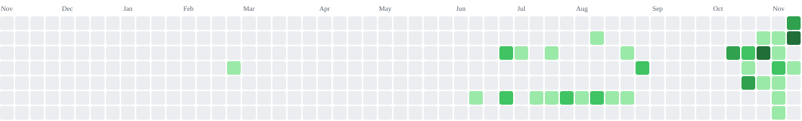

<div align="center">

<!-- ═══════════════════════════════════════════════════════════════════ -->
<!--                          HEADER BANNER                              -->
<!-- ═══════════════════════════════════════════════════════════════════ -->


<!-- ═══════════════════════════════════════════════════════════════════ -->
<!--                        TYPING ANIMATION                             -->
<!-- ═══════════════════════════════════════════════════════════════════ -->

[](https://git.io/typing-svg)

<br/>

<!-- ═══════════════════════════════════════════════════════════════════ -->
<!--                        PHOTO + STATUS PILL                          -->
<!-- ═══════════════════════════════════════════════════════════════════ -->


<br/><br/>

[](mailto:bekotemirov0@gmail.com)
[](https://maps.google.com/?q=Osh,Kyrgyzstan)

<br/>

<!-- ═══════════════════════════════════════════════════════════════════ -->
<!--                          SOCIAL BADGES                              -->
<!-- ═══════════════════════════════════════════════════════════════════ -->

<a href="https://t.me/bekokim">
  
</a>&nbsp;
<a href="mailto:bekotemirov0@gmail.com">
  
</a>&nbsp;
<a href="https://www.instagram.com/bekokim_1/">
  
</a>&nbsp;
<a href="https://github.com/Bekokim">
  
</a>

</div>

<br/>

<!-- ═══════════════════════════════════════════════════════════════════ -->
<!--                      PAC-MAN CONTRIBUTION GRAPH                     -->
<!-- ═══════════════════════════════════════════════════════════════════ -->

<div align="center">

### 👾 Pac-Man eats my commits / Пакмен ест мои коммиты

<picture>
  <source media="(prefers-color-scheme: dark)"  srcset="https://raw.githubusercontent.com/Bekokim/Bekokim/output/pacman-contribution-graph-dark.svg" />
  <source media="(prefers-color-scheme: light)" srcset="https://raw.githubusercontent.com/Bekokim/Bekokim/output/pacman-contribution-graph.svg" />
  
</picture>

<br/>

### 🧱 Tetris on my commits / Тетрис на моих коммитах

<picture>
  <source media="(prefers-color-scheme: dark)"  srcset="https://raw.githubusercontent.com/Bekokim/Bekokim/output/tetris-contribution-graph-dark.svg" />
  <source media="(prefers-color-scheme: light)" srcset="https://raw.githubusercontent.com/Bekokim/Bekokim/output/tetris-contribution-graph.svg" />
  
</picture>

</div>

---

<!-- ═══════════════════════════════════════════════════════════════════ -->
<!--                             ABOUT ME                                -->
<!-- ═══════════════════════════════════════════════════════════════════ -->

## 💻 About Me / Обо мне

```python
class BekzatErgeshov:
    """Backend developer from Osh, Kyrgyzstan 🇰🇬"""

    def __init__(self):
        self.full_name  = "Ergeshov Bekzat Askatovich"
        self.username   = "Bekokim"
        self.born       = "2006-11-05"
        self.location   = "Osh, Kyrgyzstan 🇰🇬 (UTC+6)"
        self.role       = "Backend Developer"
        self.education  = ["OshSU — Applied Math & CS (2028)",
                           "IT Academy Geeks — Backend Dev (2026)"]
        self.coding_for = "3 years"
        self.languages  = {"Kyrgyz": "native",
                           "Russian": "native",
                           "English": "A2–B1"}
        self.stack      = ["Python", "Django", "PostgreSQL",
                           "Redis", "Docker", "React"]
        self.learning   = "Data Science 📊"
        self.open_source = True   # every project I build is public
        self.looking_for = "Internship 💼"

    def say_hi(self):
        print("Thanks for stopping by! Спасибо, что заглянул!")
        print("Let's build something real together 🚀")


me = BekzatErgeshov()
me.say_hi()
```

<br/>

<div align="center">

## ⚡ Quick Facts / Коротко о главном

| | |
|:---|:---|
| 🎓 **Education / Учёба** | OshSU — Applied Math & CS `2028` · IT Academy Geeks — Backend `2026` |
| 💼 **Experience / Опыт** | Backend Intern @ Geeks Pro — 3 months |
| 🏆 **Awards / Награды** | 🥇 1st place OshSU MFTIT Informatics · 🥈 2nd place StudEXPO 2026 |
| 🔭 **Currently / Сейчас** | Building backend services with Django & PostgreSQL |
| 🌱 **Learning / Изучаю** | Data Science · ML · Pandas · NumPy |
| 💬 **Ask me about** | Python · Django · aiogram · REST API · PostgreSQL |
| 🔓 **Open Source** | All my projects are public — I believe in open source |
| 🖥️ **Setup** | VS Code · PyCharm · Vim · Antigravity IDE · Windows + Arch Linux |
| 🤖 **AI tools** | Claude Code · Codex · Kimi |
| 📫 **Email** | bekotemirov0@gmail.com |
| 🟢 **Status** | Open to internship · Remote-ready 🌍 |

</div>

---

<!-- ═══════════════════════════════════════════════════════════════════ -->
<!--                            TECH STACK                               -->
<!-- ═══════════════════════════════════════════════════════════════════ -->

<div align="center">

## 🛠️ Tech Stack / Технологии

<br/>

### 👨‍💻 Languages / Языки


<br/><br/>

### ⚙️ Frameworks & Libraries / Фреймворки


&nbsp;


<br/><br/>

### 🗄️ Databases / Базы данных


<br/><br/>

### 🧰 Tools & DevOps / Инструменты


</div>

<br/>

<div align="center">

### 📊 Skill Levels / Уровень навыков

| Skill | Level | Progress |
|:---|:---:|:---|
| 🐍 **Python** | Advanced | `█████████████████░░░` **85%** |
| 🎨 **HTML / CSS** | Advanced | `████████████████░░░░` **80%** |
| 🟨 **JavaScript** | Advanced | `███████████████░░░░░` **75%** |
| 🌐 **Django** | Advanced | `███████████████░░░░░` **75%** |
| 🔀 **Git** | Advanced | `███████████████░░░░░` **75%** |
| 🗃️ **SQLite** | Intermediate | `██████████████░░░░░░` **70%** |
| 🐘 **PostgreSQL** | Intermediate | `████████████░░░░░░░░` **60%** |
| 🔴 **Redis** | Intermediate | `████████████░░░░░░░░` **60%** |
| 🤖 **aiogram** | Intermediate | `████████████░░░░░░░░` **60%** |
| ⚛️ **React** | Intermediate | `████████████░░░░░░░░` **60%** |
| 🟦 **C#** | Basic | `██████████░░░░░░░░░░` **50%** |
| ➕ **C++** | Basic | `██████████░░░░░░░░░░` **50%** |
| 🐧 **Linux** | Basic | `████████░░░░░░░░░░░░` **40%** |
| 🐳 **Docker** | Basic | `████████░░░░░░░░░░░░` **40%** |

</div>

---

<!-- ═══════════════════════════════════════════════════════════════════ -->
<!--                             PROJECTS                                -->
<!-- ═══════════════════════════════════════════════════════════════════ -->

## 🚀 Projects / Проекты

<br/>

### 🔷 AO Studio &nbsp; `Python` `Django` `PostgreSQL` `Redis` `JavaScript`

> **EN** — My flagship project: a complete, deployed web platform built with Django on the backend, PostgreSQL for storage and Redis for caching and background tasks. Fully finished and live in production.
>
> **RU** — Мой главный проект: полноценная веб-платформа на Django, с PostgreSQL в качестве базы и Redis для кеша и фоновых задач. Полностью завершён и задеплоен.

[](https://ao-studio-main.vercel.app/)

<br/>

> 💡 **All my repositories are open source** — feel free to read, fork and learn from the code.
> 💡 **Все мои репозитории открыты** — читай, форкай и учись на коде.

---

<!-- ═══════════════════════════════════════════════════════════════════ -->
<!--                      EDUCATION & EXPERIENCE                         -->
<!-- ═══════════════════════════════════════════════════════════════════ -->

## 🎓 Education / Образование

**Osh State University** — Applied Mathematics & Computer Science
`2024 — 2028` · Osh, Kyrgyzstan

**IT Academy Geeks** — Backend Developer
`— 2026` · Course completed with certificate

**Self-taught** — 3 years of writing code every day

<br/>

## 💼 Experience / Опыт

**Backend Developer Intern** — Geeks Pro
`3 months` · Worked on backend services in a real team environment.

<br/>

## 🏆 Achievements / Достижения

| Award | Event |
|:---|:---|
| 🥇 **1st place** | Informatics Olympiad — OshSU, MFTIT Institute |
| 🥈 **2nd place** | International Programming Olympiad — StudEXPO 2026 |
| 📜 **Certificate** | Backend Developer course — IT Academy Geeks |

---

<!-- ═══════════════════════════════════════════════════════════════════ -->
<!--   OPTIONAL STATS BLOCK — раскомментируй, если захочешь показать     -->
<!-- ═══════════════════════════════════════════════════════════════════ -->
<!--
<div align="center">

## 📈 GitHub Stats


[](https://github.com/ashutosh00710/github-readme-activity-graph)

[](https://github.com/ryo-ma/github-profile-trophy)

</div>
-->

<!-- ═══════════════════════════════════════════════════════════════════ -->
<!--                          LET'S CONNECT                              -->
<!-- ═══════════════════════════════════════════════════════════════════ -->

<div align="center">

## 🤝 Let's Connect / Связаться со мной

### 💼 Available for: Internship · Part-time · Freelance · Remote 🌍

<br/>

<a href="https://t.me/bekokim">
  
</a>
<a href="mailto:bekotemirov0@gmail.com">
  
</a>
<a href="https://www.instagram.com/bekokim_1/">
  
</a>

<br/><br/>

```console
$ echo "Open to internships, open source and interesting problems."
> Open to internships, open source and interesting problems.
```

</div>


